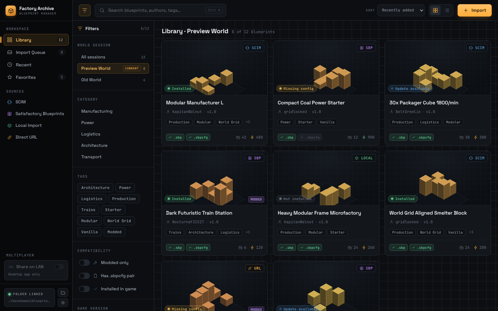
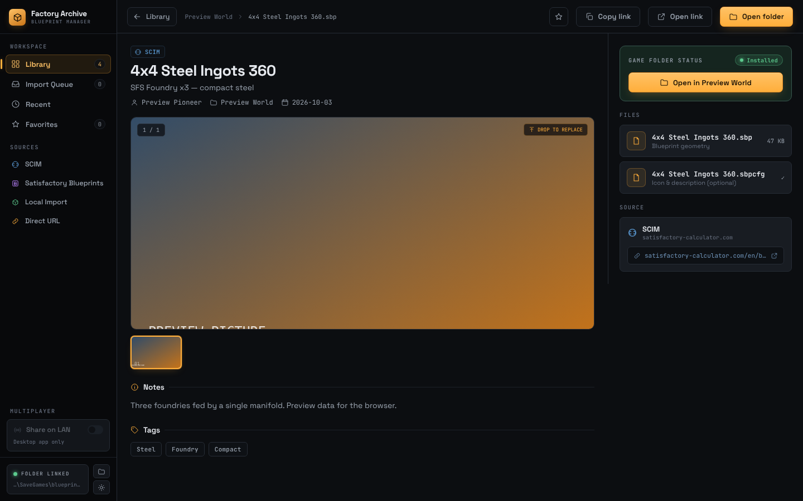
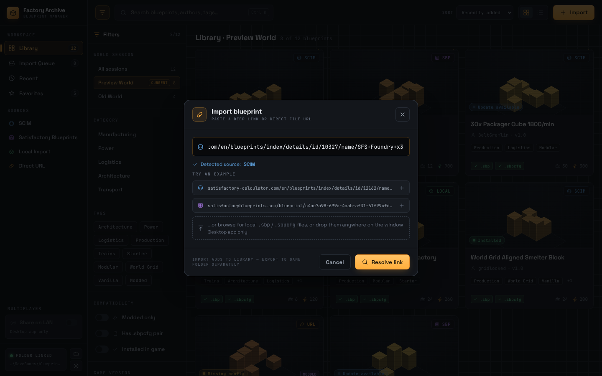

# Factory Archive

**A desktop blueprint manager for [Satisfactory](https://www.satisfactorygame.com/).** Collect, import, organize and share your `.sbp` blueprints across worlds and with friends.

[](https://github.com/mike623/factory-archive/releases/latest)
[](https://github.com/mike623/factory-archive/actions/workflows/desktop-build.yml)
[](LICENSE)
-555)



## Features

- **Your real blueprint library.** It reads the `.sbp`/`.sbpcfg` files in your game folder and groups them by **world session**. It opens on the world you're currently playing, detected from your latest autosave.
- **Import from a link.** Paste a [SCIM](https://satisfactory-calculator.com/en/blueprints) page, a [Satisfactory Blueprints](https://satisfactoryblueprints.com/) page or a direct `.sbp` URL, and the blueprint is downloaded straight into your world. The page's **picture, title, description, author, tags and source link** are saved alongside it.
- **Blueprint breakdown.** See the size, **material cost** and **buildings** (e.g. 3 × Foundry, 16 × Conveyor Belt Mk.4) of any blueprint, read from the `.sbp` file itself. It works for every blueprint, wherever it came from, and works offline.
- **Add files from disk.** Use **Browse**, or drag `.sbp`/`.sbpcfg` files anywhere onto the window.
- **Copy blueprints between worlds**, e.g. bring your favorites into a new save.
- **Share on LAN** for multiplayer. Friends on your network open the app itself in their browser, working on your blueprints: browse, download, add, rename, delete, copy between worlds and edit categories.
- **Client mode.** The Mac app (and a Windows PC switched to client) finds a host sharing on your network and joins it on its own, so you manage the host's blueprints from your own app.
- **Installs the Live mod for you.** Releases include the companion mod: click **Install Live mod** (or **Update Live mod**) in the sidebar and the app puts it in your Steam or Epic game's `Mods` folder. You can also pick a downloaded `FactoryArchiveLive.zip`. **Uninstall Live mod** removes it again (SML and other mods stay).
- **Updates itself.** Signed releases come from GitHub, with an **Install & restart** banner and a **Check for updates** button.
- Search (<kbd>Ctrl</kbd>/<kbd>⌘</kbd>+<kbd>K</kbd>), filters, favorites, grid and list views, and light and dark themes.

| Blueprint details | Import from a link |
| --- | --- |
|  |  |

## Download

Get the latest installer from **[Releases](https://github.com/mike623/factory-archive/releases/latest)**:

| Platform | File |
| --- | --- |
| Windows 10/11 | `Factory.Archive_<version>_x64-setup.exe` (or the `.msi`) |
| macOS 11+ (Apple Silicon & Intel) | `Factory.Archive_<version>_universal.dmg` |

Installed copies update themselves after that.

**First launch:** the builds aren't code-signed yet.
- **Windows:** if SmartScreen warns, click **More info → Run anyway**.
- **macOS:** right-click the app → **Open** → **Open**, or run:
  ```bash
  xattr -dr com.apple.quarantine "/Applications/Factory Archive.app"
  ```

## Using it

### Where your blueprints live

Satisfactory keeps blueprints **per world (save session)**, in one folder per session:

| Platform | Blueprints folder |
| --- | --- |
| Windows | `%LOCALAPPDATA%\FactoryGame\Saved\SaveGames\blueprints\<session>\` |

The app finds this folder automatically. If it can't, click the folder card in the sidebar and choose it yourself. The folder button next to it opens the current world's folder in Explorer or Finder.

> **After adding blueprints, reload the save.** Go to the main menu and load the world again; no restart is needed. For a dedicated server, stop the server before copying files in, then start it again.

Good to know:
- A session folder's name must match the session name exactly. A [known bug](https://wiki.indifferentbroccoli.com/Satisfactory/InvisibleBlueprintFix) can hide blueprints when the session name contains spaces or special characters.
- The `.sbp` is the blueprint itself. The `.sbpcfg` only holds its icon and description and is optional.

### Importing from a link

**Import → paste a link → Download & add.** It works with:
- **Direct `.sbp` / `.sbpcfg` links.** The matching sibling file is fetched too.
- **Blueprint pages** (SCIM, Satisfactory Blueprints…). The app follows links on the page that really download a `.sbp`/`.sbpcfg`.

It doesn't depend on any site's page layout, and it never saves an HTML page as a blueprint. If no download is found (for example because the site needs a login), it says so and writes nothing. In that case, download the files in your browser and drop them on the app.

Along with the files, the app saves the page's **picture, title, description, author, tags and link**, read from the page's standard link-preview tags. These are stored in the app's data folder, never in the game folder:
- Windows: `%APPDATA%\com.factoryarchive.app\blueprint-meta\`
- macOS: `~/Library/Application Support/com.factoryarchive.app/blueprint-meta/`

They're keyed by a hash of the blueprint's contents, so they follow it when you copy or rename it.

### Blueprint breakdown

A blueprint's detail page shows what it contains, read directly from its files:
- **Size:** the blueprint's dimensions, as stored in the file.
- **Materials:** the build cost.
- **Buildings:** each building type and how many.
- **Description and color:** the author's description and color from the `.sbpcfg`.

The format was worked out from real Satisfactory 1.0 blueprints (save version 52). Every read is bounds-checked, and the object list is checked against the size the file declares. If a file can't be read, the app says so instead of showing guessed numbers. Names come from a table of in-game names where the internal class name differs (e.g. `Desc_Cement_C` → Concrete); other names are derived from the class name.

### Multiplayer: Share on LAN

Blueprints belong to the world, so in multiplayer they live on the **host's** machine. Players who join a world see the host's blueprints, not their own.

1. The host turns on **Share on LAN** in the sidebar and sends friends the link, e.g. `http://192.168.1.20:7777`. Allow the firewall prompt on **private** networks.
2. Friends open it in any browser and get the same app, working on the host's blueprints folder. They can browse, **download** (instead of *Open folder*), add files or links, rename, delete (to the host's Trash), copy between worlds, edit categories and refetch details. Account and save copies, folder picking and the Live mod stay on the host.
3. The host's window updates and shows what friends added. The host reloads the save to see it in the game.

Instead of a browser, friends can use the app as a **client**. On a Mac it's always a client; on Windows, click **Use this PC as a client** under Multiplayer (the choice is remembered). A client searches the local network for a host on ports 7777–7786 and joins the first one it finds, or the last one it used. You can also type the host's address. Downloads go to your Downloads folder. Host and client need the same version.

The page opens on the world that's currently being played, detected from the newest `<session>_autosave_<n>.sav`. The host can pick another one under **Imports go to**.

There's no PIN, so anyone on your network can change your blueprints while sharing is on. Only turn it on at home or over a trusted VPN such as Tailscale or ZeroTier. Other safeguards:
- The server only runs while sharing is on.
- It only runs the library's own commands, always on the shared folder, and rejects path tricks, DNS rebinding and cross-site posts.
- It refuses links that point at your own network.

## Development

Factory Archive is a [Tauri 2](https://v2.tauri.app/) app: a **Rust** backend with a **React 19 + TypeScript + Vite** frontend.

### Prerequisites

- [Node.js 22+](https://nodejs.org/) and [Rust](https://rustup.rs/) (stable)
- **Windows:** Visual Studio Build Tools with *Desktop development with C++*
- **macOS:** Xcode Command Line Tools (`xcode-select --install`)
- **Linux** (for development and tests): `libwebkit2gtk-4.1-dev libgtk-3-dev librsvg2-dev`

### Run

```bash
cd app
npm install
npm run tauri dev     # desktop app with hot reload
npm run dev           # UI only, in the browser at http://localhost:1420 (sample data)
```

Browser-preview helpers: `?empty` shows the first-run screen, and `?disk` previews blueprints as if they came from disk.

### Test and check

```bash
cd app/src-tauri && cargo test     # file handling, link import (local stand-in site), share server, metadata, .sbp parsing
FA_SAMPLE_SBP=/path/to/a.sbp cargo test real_sample -- --nocapture   # optional: parse a real blueprint
cd app && npx tsc --noEmit         # TypeScript
cd app && npx vite build           # frontend build
```

### Project layout

```
app/
  src/                    React UI
    App.tsx               state, routing, filters, file operations
    library.tsx           sidebar + filter rail
    cards.tsx             top bar, grid cards, list rows
    detail.tsx            blueprint detail page
    modals.tsx            import dialog, export drawer
    copyDrawer.tsx        copy to another world
    diskLibrary.ts        reads the real library from the Rust side
    platform.ts           Tauri bridge with browser fallbacks
    styles.css            design tokens (dark default, light overrides)
  src-tauri/
    src/lib.rs            Tauri commands and app setup
    src/blueprints.rs     reading, writing, importing and copying blueprint files; session detection
    src/resolve.rs        link import: download, page links, link-preview tags, safety checks
    src/meta.rs           details and picture store, keyed by .sbp hash
    src/sbp.rs            .sbp/.sbpcfg reader: size, cost, buildings, description
    src/share.rs          Share on LAN web server (serves the app's own UI)
    tauri.conf.json       app config and updater public key
design/                   the original Claude Design prototype and chats
.github/workflows/        CI build and release
```

### Releasing

Bump `version` in `app/src-tauri/tauri.conf.json` (and `app/package.json`) and push to `main`. The **Release** workflow then builds Windows and macOS, signs the update packages, and publishes a GitHub Release with `latest.json`. Versions that already have a release are skipped. You can also push a `v*` tag or run **Release** manually from the Actions tab.

Signing uses the `TAURI_SIGNING_PRIVATE_KEY` and `TAURI_SIGNING_PRIVATE_KEY_PASSWORD` repository secrets. The matching public key is `plugins.updater.pubkey` in `tauri.conf.json`. Use a password of letters and digits only, since symbols get altered on the Windows runner.

## Contributing

Issues and pull requests are welcome.

- Please run `cargo test` and `npx tsc --noEmit` before opening a PR.
- Keep the app honest: never write placeholder or guessed data into the game folder.
- Coding agents should read [`AGENTS.md`](AGENTS.md).

## Roadmap

- Building power use and the breakdown's raw-resource totals, which need game recipe data.
- Code-signed Windows and macOS builds.
- Live refresh in-game without reloading the save. This probably needs a game mod.

## License

[MIT](LICENSE)

## Disclaimer

Factory Archive is a fan-made tool. It is not affiliated with or endorsed by Coffee Stain Studios, [Satisfactory Calculator (SCIM)](https://satisfactory-calculator.com/) or [Satisfactory Blueprints](https://satisfactoryblueprints.com/). Satisfactory is a trademark of Coffee Stain Studios. Blueprints you download belong to their authors, so respect each site's terms.
