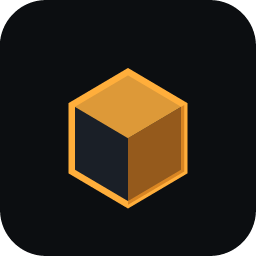
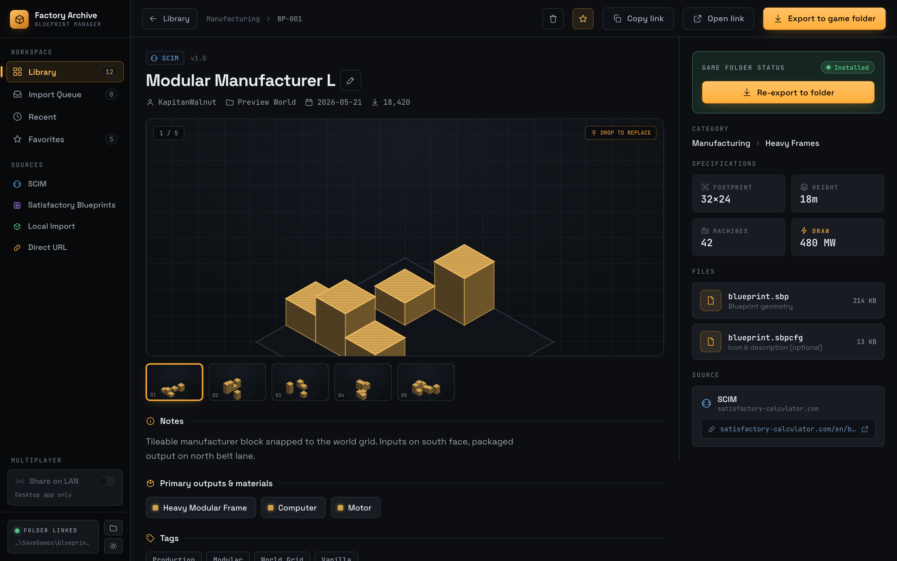
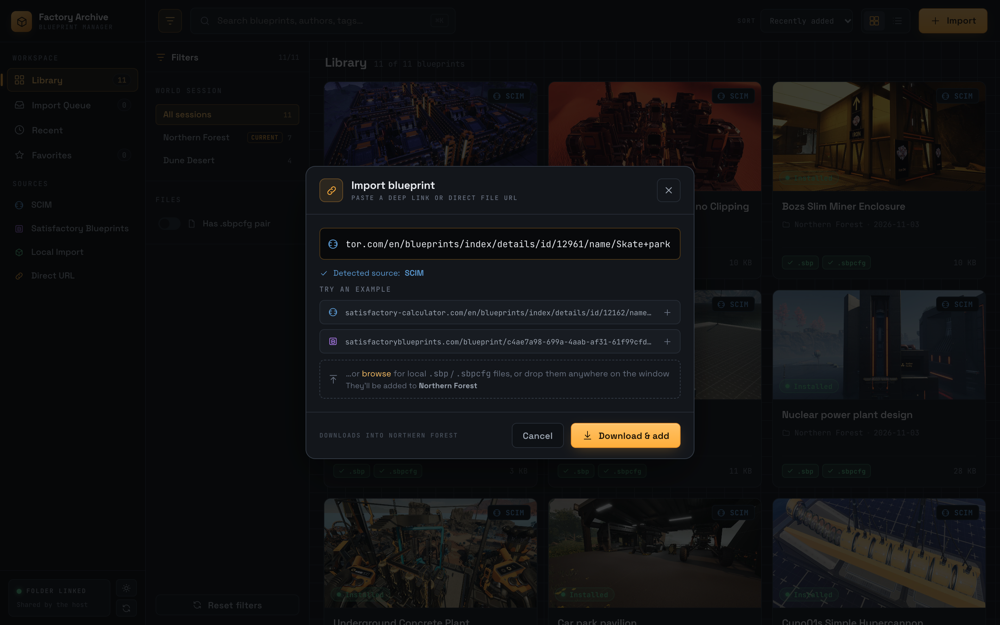
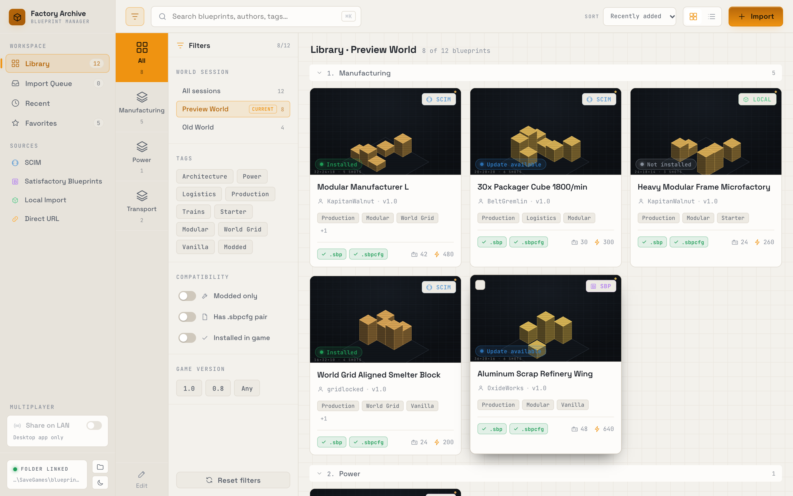

<div align="center">



# Factory Archive

[](https://github.com/mike623/factory-archive/releases/latest)
[](https://github.com/mike623/factory-archive/actions/workflows/desktop-build.yml)
[](LICENSE)


⭐ If you like this project, star it on GitHub!

[Features](#features) • [Download](#download) • [Usage](#usage) • [Multiplayer](#multiplayer) • [Sync](#sync-to-webdav) • [Development](#development)


</div>

**A desktop blueprint manager for [Satisfactory](https://www.satisfactorygame.com/).** Collect, import, organize and share your `.sbp` blueprints across worlds and with friends, without digging through the game's save folders.

## Features

- **Your real library.** Reads the `.sbp`/`.sbpcfg` files in your game folder, grouped by world, and opens on the world you're playing.
- **Import from a link.** Paste a [SCIM](https://satisfactory-calculator.com/en/blueprints) page, a [Satisfactory Blueprints](https://satisfactoryblueprints.com/) page, a SCIM user profile or a direct `.sbp` URL. The files land in your world, with the page's picture, title, author and tags.
- **Blueprint breakdown.** Size, material cost and buildings, read from the `.sbp` itself. Works offline, for any blueprint.
- **Organize.** Search (<kbd>Ctrl</kbd>/<kbd>⌘</kbd>+<kbd>K</kbd>), filters, favorites, grid and list views, game categories, copy between worlds, drag and drop from disk.
- **Multiplayer.** Share your library on the LAN; friends use the same app in a browser or in client mode.
- **WebDAV sync.** Back up to InfiniCLOUD, Nextcloud, Synology or your own server, with every upload verified.
- **Live mod installer** and **self-updating** signed releases.

| Blueprint details | Import from a link | Light theme |
| --- | --- | --- |
|  |  |  |

## Download

Get the latest installer from **[Releases](https://github.com/mike623/factory-archive/releases/latest)**. Installed copies update themselves.

| Platform | File |
| --- | --- |
| Windows 10/11 | `Factory.Archive_<version>_x64-setup.exe` (or `.msi`) |
| macOS 11+ (Apple Silicon & Intel) | `Factory.Archive_<version>_universal.dmg` |

> [!NOTE]
> Builds aren't code-signed yet. On **Windows**, if SmartScreen warns, click **More info → Run anyway**. On **macOS**, right-click the app → **Open**, or run:
> ```bash
> xattr -dr com.apple.quarantine "/Applications/Factory Archive.app"
> ```

## Usage

### Where blueprints live

Satisfactory keeps blueprints **per world (save session)**. The app finds the folder on its own; in host mode you can click the folder card in the sidebar to pick another.

| Platform | Blueprints folder |
| --- | --- |
| Windows | `%LOCALAPPDATA%\FactoryGame\Saved\SaveGames\blueprints\<session>\` |
| macOS (CrossOver) | `~/Library/Application Support/CrossOver/Bottles/<bottle>/drive_c/users/<user>/AppData/Local/FactoryGame/Saved/SaveGames/blueprints/<session>/` |

On macOS the app checks CrossOver's default Bottles folder for Satisfactory data and starts as a host if it finds some, otherwise as a [client](#multiplayer). Run the game once first.

> [!IMPORTANT]
> **Reload the save after adding blueprints.** Go to the main menu and load the world again; no restart needed. For a dedicated server, stop it before copying files in.

> [!TIP]
> If blueprints don't show up in game, check the session folder name matches the session exactly. A [known game bug](https://wiki.indifferentbroccoli.com/Satisfactory/InvisibleBlueprintFix) hides blueprints when the name has spaces or special characters.

### Import from a link

**Import → paste a link → Download & add.** The app follows links on the page that really download a `.sbp`/`.sbpcfg`, and fetches the matching sibling file for direct links. It never saves an HTML page as a blueprint: if no download is found (for example behind a login), it says so and writes nothing. Download the files in your browser and drop them on the window instead.

Page details (picture, title, description, author, tags, link) are stored in the app's data folder, never in the game folder, keyed by a hash of the blueprint so they follow it when copied or renamed:

- Windows: `%APPDATA%\com.factoryarchive.app\blueprint-meta\`
- macOS: `~/Library/Application Support/com.factoryarchive.app/blueprint-meta/`

### Blueprint breakdown

The detail page shows the blueprint's size, materials, buildings, description and color, read straight from its files. Every read is bounds-checked; if a file can't be read, the app says so instead of guessing.

## Multiplayer

Blueprints belong to the **world**, so in multiplayer they live on the host's machine.

1. The host turns on **Share on LAN** in the sidebar and sends friends the link, e.g. `http://192.168.1.20:7777`. Allow the firewall prompt on **private** networks.
2. Friends open it in a browser and get the same app on the host's blueprints: browse, download, add, rename, delete, copy between worlds, edit categories.
3. The host reloads the save to see the changes in game.

Instead of a browser, friends can click **Use this PC as a client** under *Multiplayer*. A client scans the local network (ports 7777–7786) and joins the first host it finds, or the last one it used. Host and client need the same version.

> [!WARNING]
> Sharing has **no password**: anyone on your network can change your blueprints while it's on. Only use it at home or over a trusted VPN (Tailscale, ZeroTier). The server only runs while sharing is on, only runs the library's own commands, and rejects path tricks, DNS rebinding, cross-site posts and links to your own network.

## Sync to WebDAV

Click **Sync** in the top bar, paste your WebDAV address and a token, then **Test** and **Sync now**.

- Free option: [InfiniCLOUD](https://infini-cloud.net/en/) (20 GB). Under **My Page → Apps Connection**, copy the WebDAV URL, your user ID (*Username*) and the apps password (*Token*).
- Files go under `<address>/.factory-archive/blueprints/<world>/`. Each upload is downloaded again and compared by SHA-256 before it counts; only changed files are sent.
- The token is stored in the app data folder (mode `0600`), never logged and never sent to the share page.
- **Sync automatically when the app opens** re-checks on start and on focus, at most every 5 minutes, and only when the folder has been quiet for 10 seconds.

<details>
<summary><b>Deletions and conflicts</b></summary>

**Deletions.** A blueprint you delete or rename here is removed from the backup too (untick *Remove files from the backup that I deleted here* to keep them). Nothing is removed when the local folder is empty, when any upload in the run failed, or beyond 50 files in an automatic run. Nothing outside `.factory-archive/blueprints/` is touched.

**Which version wins.** A state file on each side (`<app data>/backup/backup-index.json` and `.factory-archive/sync-state.json`) lets the dialog say which side changed:

- **Both sides match**: nothing to do.
- **Changes here**: *Sync now* uploads them.
- **Cloud changes** or **both changed**: pick *Keep this PC's version* or *Use the cloud copy* for the whole library.
- **Different folder**: uploads work, but removals stay paused until you tick *I mean this folder*.

*Use the cloud copy* keeps each replaced local file as `<name>.sbp.bak` (ignored by the game), checks downloads against the recorded SHA-256, and never deletes local-only files. When both sides moved, automatic sync stops and asks you instead of guessing.

</details>

## Live mod

Releases bundle the companion Live mod. Click **Install Live mod** (or **Update Live mod**) in the sidebar and the app installs it into your Steam or Epic game's `Mods` folder, or pick a downloaded `FactoryArchiveLive.zip`. **Uninstall Live mod** removes only this mod.

## Development

Factory Archive is a [Tauri 2](https://v2.tauri.app/) app: a **Rust** backend and a **React 19 + TypeScript + Vite** frontend.

### Prerequisites

- [Node.js 22+](https://nodejs.org/) and [Rust](https://rustup.rs/) (stable)
- **Windows:** Visual Studio Build Tools with *Desktop development with C++*
- **macOS:** Xcode Command Line Tools (`xcode-select --install`)
- **Linux** (tests only): `libwebkit2gtk-4.1-dev libgtk-3-dev librsvg2-dev`

### Run

```bash
cd app
npm install
npm run tauri dev   # desktop app with hot reload
npm run dev         # UI only, with sample data, at http://localhost:1420
```

Add `?empty` to the browser URL for the first-run screen, or `?disk` to preview on-disk blueprints.

### Test

```bash
cd app/src-tauri && cargo test            # Rust: files, link import, share server, .sbp parsing
cd app && npx tsc --noEmit && npx vite build
cd app && node --test src/platform.test.mjs
```

> [!TIP]
> Check the parsers against your own files with `FA_SAMPLE_SBP=/path/to/a.sbp cargo test real_sample -- --nocapture`, or `FA_SAMPLE_SAV` for saves.

### Project layout

```
app/src/          React UI (App.tsx state, library/cards/detail/modals views, platform.ts Tauri bridge)
app/src-tauri/    Rust: blueprints, link import, .sbp/.sav readers, share server, WebDAV sync, mod installer
mod/              the Live mod
design/           original design prototype (reference only)
```

See [`AGENTS.md`](AGENTS.md) for module details, conventions and the project's hard rules (never write guessed data into the game folder, never overwrite a blueprint or save).

### Releasing

Bump `version` in `app/src-tauri/tauri.conf.json` and `app/package.json`, then push to `main`. The **Release** workflow builds Windows and macOS, signs the update packages and publishes a GitHub Release with `latest.json`. Signing uses the `TAURI_SIGNING_PRIVATE_KEY` and `TAURI_SIGNING_PRIVATE_KEY_PASSWORD` repository secrets.

---

<sub>Factory Archive is a fan-made tool, not affiliated with or endorsed by Coffee Stain Studios, [SCIM](https://satisfactory-calculator.com/) or [Satisfactory Blueprints](https://satisfactoryblueprints.com/). Satisfactory is a trademark of Coffee Stain Studios. Downloaded blueprints belong to their authors; respect each site's terms.</sub>
